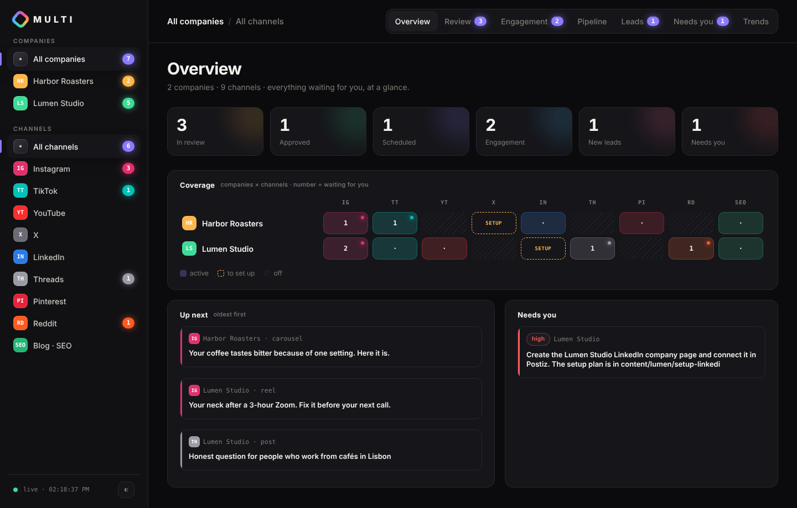
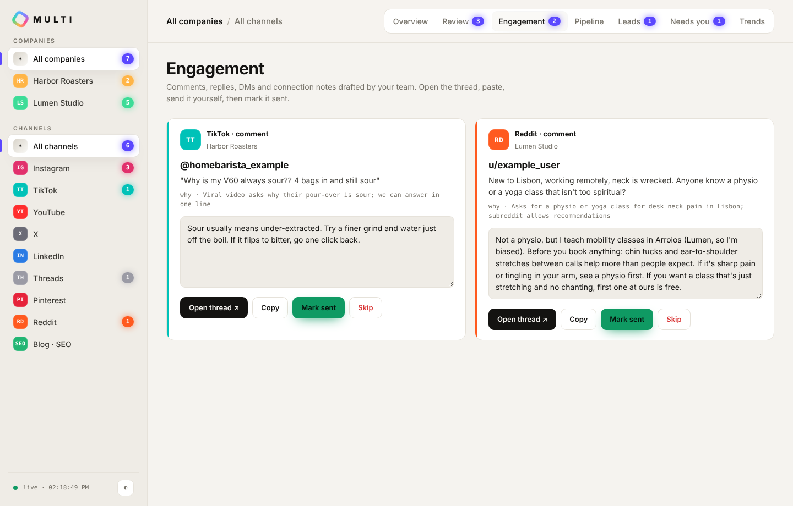
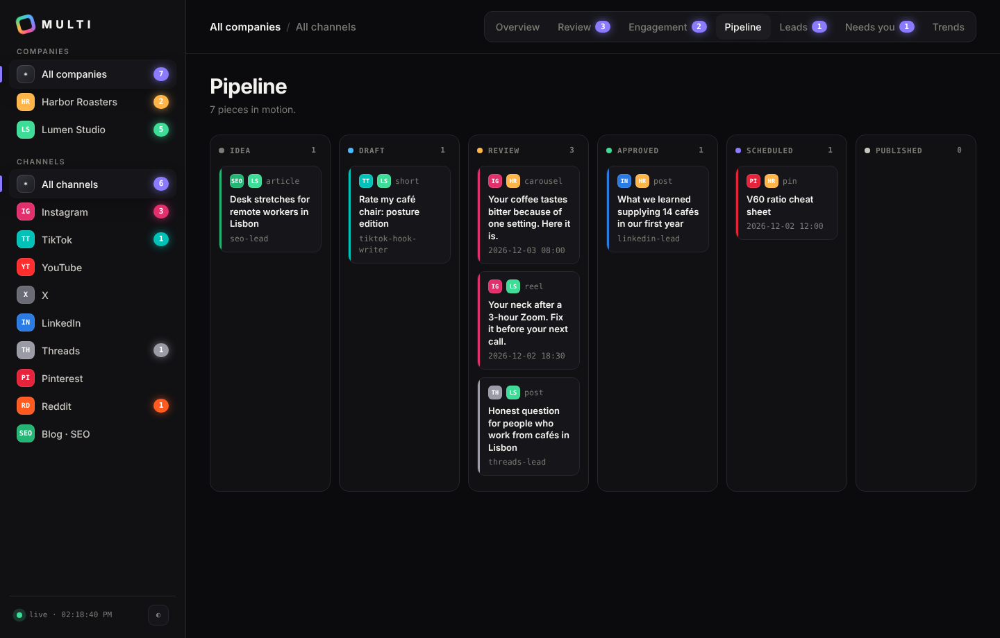

# MULTI

**A social media department for Claude.** 46 agents organised into platform teams, a weekly content cycle, a daily engagement queue, and a local dashboard where a human approves everything before it goes out.

Run every brand you own from one place: YouTube, Instagram, TikTok, X, LinkedIn, Threads, Pinterest, Reddit and SEO, each with its own team and a lead who signs off before you see it.



## Why MULTI

Most "AI social media" tools are either a scheduler with a caption button, or a bot that posts on its own and gets the account flagged. MULTI works like a real agency instead:

- **Teams, not prompts.** Each platform has a lead plus specialists (scriptwriter, thumbnail designer, carousel designer, hook writer, SEO...). Shared roles research trends, break down why posts went viral, guard the brand, and learn from last week's numbers.
- **A human approves every post.** Leads move work to `review`; only you move it to `approved`. Comments, DMs and connection notes are drafts you send yourself.
- **It sounds like you.** Every human-facing line goes through a humanizer calibrated on things you actually wrote.
- **Plain files.** State is markdown in a folder. No database, no vendor lock-in; sync it with git, Dropbox or iCloud.
- **Many brands.** Each brand has its own brief, voice, platforms and quotas. One dashboard for all of them.

## Install

**As a Claude Code plugin**

```bash
/plugin marketplace add dellalimov/multi
/plugin install multi@multi
```

**Dashboard** (Node 18+, no dependencies)

```bash
npx github:dellalimov/multi init            # creates ./multi-workspace
npx github:dellalimov/multi dashboard       # opens http://localhost:4747
```

Try it with the example brand: `npm run demo` from a clone.

## Use

In Claude Code, inside the folder that holds your workspace:

| You say | What runs |
|---|---|
| `/multi:multi-brand-onboarding` | Interviews you, reads your site, writes the brand brief, voice samples and setup tasks |
| `/multi:multi-weekly` | Trends → virality patterns → plan → drafts per platform → lead review → batch in your dashboard |
| `/multi:multi-daily-engagement` | Listening, inbound replies, outbound reply drafts, LinkedIn notes, lead follow-ups |
| `/multi:multi-publish` | Schedules everything you approved through Metricool or Postiz |

Then open the dashboard:

- **Companies and channels in the sidebar.** Pick a company, a channel, or both; every view filters to that scope, with live counters of what waits for you.
- **Coverage matrix.** Every company × channel at a glance: active, still to set up, or off, and how many items are waiting. Click a cell to jump into that pipeline.
- **Review.** Approve, or send back with a note the team reads next run.
- **Engagement.** Edit the draft, open the thread, copy, send it yourself, mark it sent.
- **Pipeline, Leads, Needs you, Trends.** Kanban by stage, lead status, the tasks only you can do, the latest research.
- Dark and light themes, keyboard shortcuts `1`–`7` for the tabs, and live sync with the workspace files every few seconds.

Give each company its own accent with `color: "#hex"` in its brief.

| Review | Engagement (light) |
|---|---|
|  |  |



## The org chart

```
You (approve)
└── CMO ─ sets quotas per brand × platform, assembles your batch
    ├── Research:  trend-scout · listening · virality-analyst · x-intelligence
    ├── Quality:   brand-guardian · compliance · humanizer (skill)
    ├── Growth:    repurposer · analyst · paid-amplifier · creator-outreach
    ├── Inbound:   community-manager · lead-router · crisis-desk · reputation
    ├── Outbound:  engagement-scout · linkedin-networker · backlink-outreach
    ├── Ops:       publisher · account-setup
    └── Platform teams (lead + specialists)
        YouTube    lead · scriptwriter · thumbnail-designer · editor · seo
        Instagram  lead · reels-writer · carousel-designer · stories
        TikTok     lead · hook-writer · editor
        X          lead · writer · intelligence
        LinkedIn   lead · writer · carousel-designer · networker
        Threads    lead · writer
        Pinterest  lead · designer
        Reddit     lead · writer
        SEO        lead · strategist · writer · backlink-outreach
```

All agents live in [`agents/`](agents). Each one is a short markdown file you can edit.

## How a week runs

1. **Research.** Trend scout and listening collect what the brand's audience talks about this week; the virality analyst turns the best posts into rules.
2. **Plan.** The CMO creates ideas per brand × platform from the brief's quotas.
3. **Produce.** Each platform lead assigns ideas to its specialists. The repurposer turns one long piece into native posts for every other platform.
4. **Review.** Brand guardian (and compliance for regulated topics) checks every draft; the humanizer runs last; the lead moves it to `review`.
5. **You approve** in the dashboard. The publisher schedules approved items.
6. **Learn.** The analyst writes what worked into `learnings.md`, which every team reads next week.

## Workspace

```
multi-workspace/
  brands/<brand>/brief.md          voice, audience, offers, never-list, active platforms
  brands/<brand>/voice-samples.md  real things you wrote (humanizer input)
  brands/<brand>/learnings.md      do more / stop doing
  content/<brand>/*.md             posts, reels, threads, videos, articles
  engagement/<brand>/*.md          drafted comments, replies, DMs, connection notes
  leads/<brand>/*.md               people with buying intent
  trends/<brand>/<date>.md         weekly research
  tasks/*.md                       things only you can do
```

Full format: [`docs/WORKSPACE.md`](docs/WORKSPACE.md).

## Publishing

MULTI does not hold your social logins. It schedules through a tool you already trust:

- **[Metricool](https://metricool.com)** via its MCP connector (supports "for review" posts).
- **[Postiz](https://github.com/gitroomhq/postiz-app)**, open source and self-hostable, via its MCP server or CLI.

For inbound comments and DMs on your own accounts, use the platforms' official APIs (Instagram Messaging API, YouTube Data API) or your scheduler's inbox.

## Ground rules

MULTI is built to grow real accounts, not to fake activity:

- Agents never post, comment, DM or send connection requests on their own, and never drive a browser to do it.
- Outbound replies are disclosed as the brand or its founder and must be useful without the link.
- No fake reviews, fake customer stories, sock-puppet accounts, link schemes or engagement pods.
- Platform rules and community rules (subreddit sidebars) win over quotas.

Accounts that work this way are far less likely to be restricted, and their audience trusts them.

## Works well with

- [humanizer](https://github.com/blader/humanizer) by Siqi Chen (bundled, MIT)
- [agency-agents](https://github.com/msitarzewski/agency-agents) for engineering, design and sales roles
- Media tools with MCP servers (Higgsfield, fal, Kling, Canva, Figma) for the editors and designers

## Contributing

New platform teams, better role prompts and dashboard views are welcome. Keep agents short and specific, run `npm test`, and open a PR.

## License

MIT. The bundled humanizer skill is MIT, © 2025 Siqi Chen.
